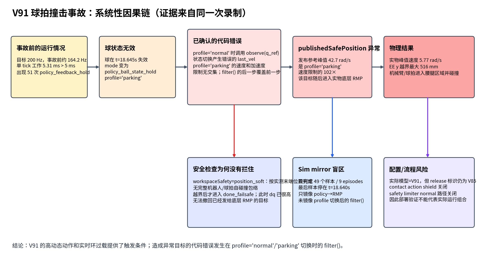
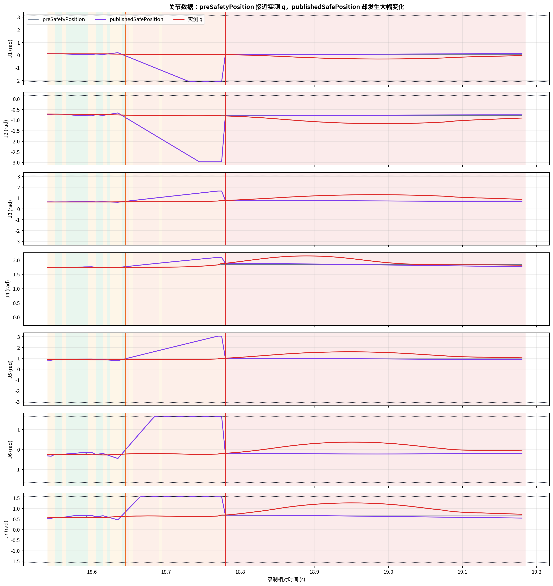
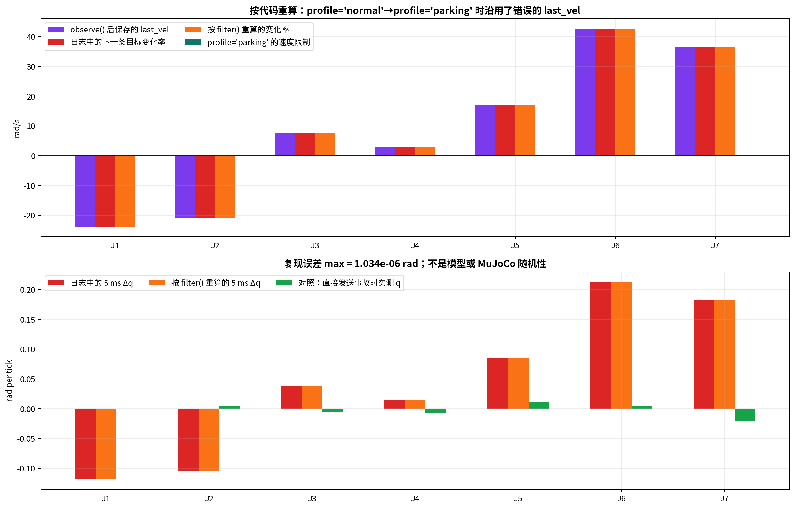
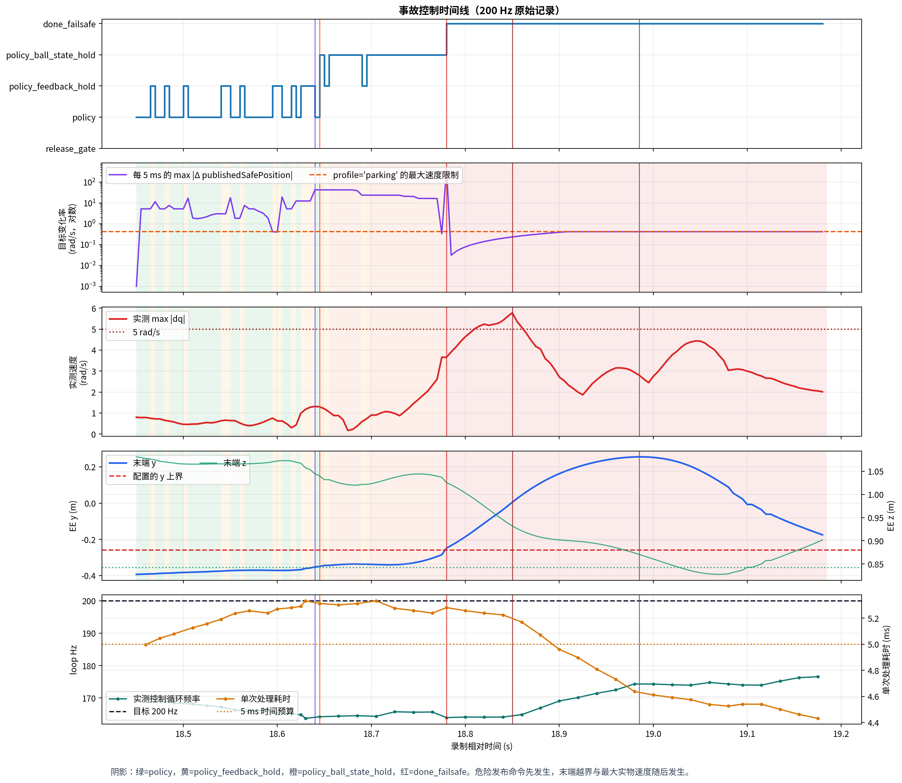
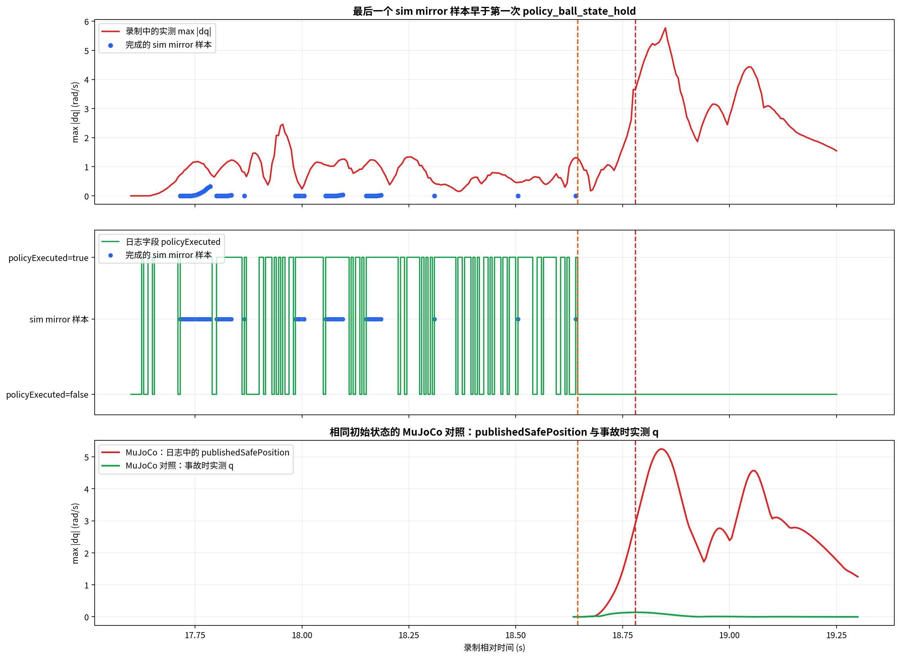
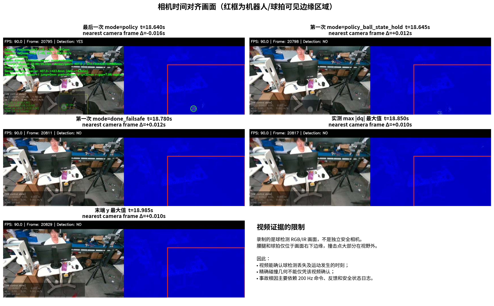

# V91 球拍撞击事故分析（大白话版）

录制目录：`probe_recording_20260829_141442`

## 本文使用的名称

本文不再给程序状态另起名字，只使用日志和代码里的原名：

| 原名 | 它在本次运行中的实际含义 |
|---|---|
| `mode=policy` | 本周期使用策略算出的关节目标。 |
| `mode=policy_feedback_hold` | 关节反馈不满足要求，本周期不运行策略，目标设为当时测到的关节角。 |
| `mode=policy_ball_state_hold` | 球状态无效或过期，本周期不运行策略，目标设为当时测到的关节角。 |
| `mode=done_failsafe` | 工作空间检查已经报错，程序进入事故后的持续处理状态。 |
| `profile='normal'` | `mode=policy` 发布命令时传给限速器的参数名。 |
| `profile='parking'` | 两种 `*_hold` 发布命令时传给限速器的参数名，速度和加速度限制更低。 |
| `profile='reset'` | `mode=reset` 发布命令时传给限速器的参数名。 |

`parking hold` 不是代码中的名称，本文不再使用。需要同时说明状态和发布参数时，会明确写成例如：

```text
mode=policy_ball_state_hold，profile='parking'
```

## 先说结论

这次事故不是因为“策略还想继续打球”，也没有证据表明是 RMP 的 PD 参数写错了。

真正的问题发生在策略命令发给机器人之前的最后一道限速程序里：

1. 程序发现球状态不再可靠，于是停止使用策略输出。
2. 程序原本想让机器人保持在当时的位置，也就是“先别动”。
3. 但限速程序把上一次命令跳变误当成了机器人真实速度。
4. 这个错误速度大到离谱，导致“最大速度限制”和“最大加速度限制”互相矛盾。
5. 代码没有识别这个矛盾，反而算出了一条更快的命令，并把它发给了机器人。
6. 随后机械臂快速向腰腿方向运动，工作空间检查在坏命令已经发出后才触发停机。

一句话概括：

> 进入 `mode=policy_ball_state_hold` 后，本来应该把目标设成当时测到的关节角，但发送前的限速代码算错了，实际发成了“多个关节目标突然大幅改变”。

这不是猜测。录制数据可以逐个时间点重算出程序当时发出的错误命令，重算结果与日志最大只差 `0.00000103 rad`，差异来自日志保留的小数位数。



## 一、最直接的证据：保持命令被改坏了

最后一次 `mode=policy` 命令出现在 `18.640 s`。紧接着的 `18.645 s`，球状态不可用，程序进入 `mode=policy_ball_state_hold`，并把原始目标设成当时测到的关节角。

在这个时刻：

- “保持当前位置”的输入是合理的，基本等于机器人当时测到的关节角。
- 经过限速程序后，最终发出的关节目标却突然大幅跳变。
- 这次跳变只用了一个控制周期，也就是约 `5 ms`。

三个最明显的关节如下：

| 关节 | 上一周期发出的目标 | 本周期原本想保持的位置 | 最终实际发出的目标 | 5 ms 内突然变化 |
|---|---:|---:|---:|---:|
| J1 | 0.072945 rad | 0.072236 rad | -0.046034 rad | -0.118979 rad，约 -6.82° |
| J6 | -0.241388 rad | -0.236344 rad | -0.028020 rad | +0.213368 rad，约 +12.23° |
| J7 | 0.644862 rad | 0.624459 rad | 0.826675 rad | +0.181813 rad，约 +10.42° |

以 J6 为例，目标位置在 `5 ms` 内跳了 `12.23°`，相当于目标变化速度：

```text
42.674 rad/s ≈ 2445°/s
```

但 `profile='parking'` 为 J6 设置的最大速度只有：

```text
0.419 rad/s ≈ 24°/s
```

也就是说，最终发出的目标变化速度是设置上限的约 `102 倍`。所以问题不是“限制稍微超了一点”，而是限速功能在切换状态时完全失效了。



## 二、限速程序为什么会把命令改得更危险

下面只看 J6，就能把这个 BUG 说清楚。

### 第一步：程序记住了一个假的“上次速度”

在 `18.640 s`，程序内部记住的 J6 速度是：

```text
42.689 rad/s
```

这并不是传感器测到的关节速度。它是用“本周期目标位置减去上周期目标位置，再除以 5 ms”算出来的。

问题在于，这两个目标来自不同的 `mode`：`18.625～18.635 s` 是 `mode=policy_feedback_hold`，`18.640 s` 又变成 `mode=policy`。因此两条命令之间的差，被错误地当成了机器人真实速度。

### 第二步：两条限制已经互相打架

当程序在 `18.645 s` 进入 `mode=policy_ball_state_hold`，并使用 `profile='parking'` 时，对 J6 同时有两条要求：

- 最大速度要求：新速度必须在 `-0.419 ～ +0.419 rad/s` 之间。
- 最大加速度要求：因为程序误以为上次速度是 `42.689 rad/s`，所以新速度只能在大约 `42.673 ～ 42.705 rad/s` 之间。

这两个范围没有任何重叠：

```text
速度限制允许：       -0.419 ───────── +0.419
加速度限制允许：                              42.673 ─ 42.705
```

正常做法应该是：发现两条限制无法同时满足，立即拒绝发送命令，清空错误的历史速度，并保持当前测量位置。

### 第三步：现有代码没有报错，而是把坏速度发了出去

现有代码按顺序做了两次截断：

1. 先按最大速度限制，把速度压到 `0.419 rad/s`。
2. 再按最大加速度限制，又把它改成 `42.673 rad/s`。

第二步把第一步的速度限制覆盖掉了，于是本应限速的程序反而制造了超高速目标。

这不是只发生在 J6。事故时刻 7 个关节的两组限制全部没有交集。



相关代码位置：

- `interactive_policy_safety_probe.py`：正常 GPU 策略路径把新命令交给限速器“记住”。
- `safety_limiter.py`：用相邻两条目标命令计算历史速度，然后依次执行速度限制和加速度限制。

这里的核心错误是：**切换控制状态时，不能把两种不同来源的目标命令之差，当成机器人真实速度继续使用。**

## 三、事故是怎么一步步发生的

| 相对时间 | 程序和机器人发生了什么 |
|---:|---|
| 17.625 s | 策略开始控制。 |
| 18.625～18.635 s | 日志为 `mode=policy_feedback_hold`，原因是 `source_sequence_gap`。 |
| 18.640 s | 日志恢复为 `mode=policy`。限速器把这次状态切换造成的目标差记成了 `42.689 rad/s` 的假速度。 |
| 18.645 s | 日志变为 `mode=policy_ball_state_hold`，发布时使用 `profile='parking'`；限速 BUG 在这一周期产生了巨大目标跳变。 |
| 18.780 s | 工作空间检查第一次报错，日志变为 `mode=done_failsafe`。距离坏命令已经过去约 135 ms。 |
| 18.850 s | 记录到最大实际关节速度 `5.772 rad/s`，约 `331°/s`。 |
| 18.985 s | 按机器人正向运动学计算，末端 y 坐标达到 `+0.256 m`；设置的上边界是 `-0.260 m`，超出约 `0.516 m`。 |

这里要特别说明：`0.516 m` 是计算出的末端 y 坐标相对边界的超出量，不等于球拍沿直线实际移动了 51.6 cm。

从第一条坏命令到工作空间报警，中间有约 `135 ms`。从报警到最大实际关节速度，又过了约 `70 ms`。这说明报警发生时，机械臂已经收到多条坏命令并开始运动，电机和机械结构也有惯性。此时再进入 reset，不能瞬间把已经发生的运动消掉。

所以用户看到的“点 reset 没有用”，并不是网页按钮完全没发送，而是 reset 启动得太晚，而且 reset 本身也要通过同一套命令发送和限速逻辑。



## 四、各部分分别负什么责任

### 1. V91 新模型：是触发条件和放大因素，但不是限速 BUG 的根源

V91 的策略动作更激烈，部分时段 J7 接近动作范围边缘，更容易让相邻目标差变大，也更容易触发保持与恢复之间的跳变。

但是在最终事故时刻，日志已经变为 `mode=policy_ball_state_hold`，程序停止采用 V91 的新动作。送进限速器的是当时测到的关节角，这条输入本身没有要求机器人冲向腰部。

因此：

- V91 让问题更容易暴露、后果更严重。
- 真正把“保持”改成高速目标的是公共的实物命令限速代码。
- 换回 V85 不能证明安全，因为 V85 也会经过同一段代码；只是目前没有数据证明 V85 一定会造成同样严重的动作。

### 2. 控制循环跑得不够稳：增加了状态切换和命令跳变的机会

程序目标频率是 `200 Hz`，也就是每 `5 ms` 运行一次。事故附近记录到：

- 实际约 `164.2 Hz`。
- 单次处理耗时约 `5.31 ms`，已经超过 `5 ms` 的预算。
- 累计出现 `1099` 次超时。
- 策略阶段出现 `51` 次 `mode=policy_feedback_hold`。

“反馈序号不连续”用大白话说，就是：程序看到的反馈编号中间有跳号，所以安全逻辑要求临时保持。日志同时显示控制循环只有约 `164.2 Hz`，处理速度不足是一个明确风险；但只凭现有日志，不能把每一次跳号都断定为程序处理太慢，通信延迟或丢包也可能造成跳号。

循环变慢不是这次高速命令的直接计算原因，但它让 `mode=policy` 与 `mode=policy_feedback_hold` 之间的切换更加频繁，增加了触发限速 BUG 的机会。

### 3. 实物发送前的限速程序：这是已经确认的主要软件故障

这段程序本应是最后一道保护，却存在三个直接问题：

- 把目标命令的跳变当成真实关节速度。
- 切换控制状态时没有清空上一状态留下的速度。
- 两条限制互相矛盾时没有拒绝命令，反而让后执行的限制覆盖了前一个限制。

这三点组合起来，足以解释录制中的全部异常目标，并且可以用日志精确复现。

### 4. RMP 和 PD 参数：目前没有证据表明它们写错了

实物底层已经有 RMP，不需要、也不应该在上层再实现一个重复的 RMP。

本次记录中的仿真使用的是 simcode7 指定的参数：

```text
Kp = [112320, 184320, 133650, 73200, 30420, 62100, 35100]
Kv = [9048, 9604.8, 9570, 4071.6, 3712, 5000, 2030]
```

目前没有证据表明这组参数填错或没有生效。即使不怀疑底层 RMP，仅靠上层实际发出的巨大关节目标跳变，也足以解释机器人为何突然加速。

### 5. 工作空间检查：它是“越界后报警”，不是防撞系统

当前检查主要看机械臂末端一个点的当前位置是否越过边界。它有三个局限：

- 不检查整条机械臂、球拍和腰腿之间是否将要相撞。
- 不根据当前速度预测几十毫秒后的运动。
- 只有测量位置已经越界后才会触发。

因此它发现了事故，但没有来得及阻止事故。

### 6. Reset：不是最初原因，但现有 reset 也不够安全

Reset 采用固定关节目标回位，不是经过碰撞规划得到的安全路径。机器人已经处在腰腿附近或高速运动时，直接回固定姿态可能继续扫过危险区域。

本次最初的异常运动不是 reset 产生的，但 reset 不能作为这种事故的可靠补救手段。

### 7. 版本名称不一致：不是直接原因，但会妨碍排查

本次运行实际选中的是 V91 模型，但部分发布信息仍显示 V85。这不会直接制造高速命令，但会让人误判“到底跑的是哪个模型”，属于必须修正的版本管理问题。

## 五、为什么打开 sim mirror 还是没有提前发现

这次 sim mirror 一共只完成：

- `49` 个仿真样本；
- `9` 个短片段；
- 最后一个仿真输入时间是 `18.640 s`。

而第一条危险命令发生在 `18.645 s` 的 `mode=policy_ball_state_hold`。也就是说，sim mirror 恰好停在事故前一个控制周期，没有仿真到那条坏命令。

更关键的是，当时的 sim mirror 主要检查：

```text
策略输出 → simcode7 的积分路径 → 恢复出的 RMP 执行效果
```

但这次 BUG 发生在：

```text
实物端最终发布命令 → mode 与 profile 切换 → 限速程序 filter()
```

这部分没有被原来的 sim mirror 完整复刻。因此，“sim mirror 已开启”不等于“实际要发给机器人的最终命令已经通过安全验证”。



## 六、离线 MuJoCo 对照实验说明了什么

我从事故前相同的局部初始状态出发，做了两组对照：

### A. 重放录制中最终实际发布的目标

- 最大关节速度：`5.248 rad/s`
- 球拍 y 坐标最大值：`+0.295 m`
- 球拍最低高度：`0.810 m`

### B. 球状态丢失时，直接以当前测量位置重新建立“保持”，并清零历史命令速度

- 最大关节速度：`0.141 rad/s`
- 球拍 y 坐标最大值：`-0.355 m`
- 球拍最低高度：`1.025 m`

这个对照说明：从同一局部状态出发，危险运动来自“最终发布目标”的异常跳变；如果保持命令在切换时正确重新建立，运动会小得多。

这只是事故边界附近的局部对照，不是对整段实物碰撞、接触力和球拍断裂过程的精确复现。

## 七、哪些事情已经确定，哪些还不能确定

### 已经由日志和代码确认

1. `18.645 s` 的原始保持目标接近实物测量位置，本身没有要求大幅运动。
2. 最终发布目标在一个周期内发生了巨大跳变。
3. 跳变发生在发送前的限速程序中。
4. 该程序内部使用了由不同状态目标计算出的假速度。
5. 7 个关节的速度限制与加速度限制在该时刻全部互相矛盾。
6. 用相同算法可以把日志中的错误目标重算出来。
7. 工作空间报警和 reset 都发生在坏命令已经发出、机器人已经开始运动之后。

### 现场描述和数据能够共同支持

- 用户现场观察到球拍撞向机器人腰腿并断裂。
- 关节数据和正向运动学确认机械臂在同一时段快速向该方向越界。

### 现有材料不能精确确定

- 球拍第一次接触腰部还是腿部的准确时间。
- 具体是球拍哪个部位、机器人哪个外壳位置先接触。
- 接触力峰值和球拍断裂瞬间。

原因是录制视频主要用于观察球，腰腿和球拍大部分时间处在画面底部或画面外，系统也没有接触力传感记录。报告不会用猜测补上这些缺失信息。



## 八、再次上实物前必须完成的修改

### 第一优先级：先堵住会发高速目标的代码漏洞

1. 每次从 `mode=policy` 切换到 `mode=policy_feedback_hold`、`mode=policy_ball_state_hold`、`mode=done_failsafe` 或 `mode=reset` 时，都用最新实物测量位置重新建立目标，并把限速器保存的 `last_vel` 清零。
2. 如果最大速度限制和最大加速度限制没有共同可行范围，禁止发送算出的目标；只能发送经过单独验证的当前位置保持命令，并锁住发送功能等待人工重新启用。
3. 在消息真正发布前，再做一遍独立检查：任一关节的“本周期目标减上周期目标”超过允许值，就不发送，并明确报警。
4. `mode=policy_feedback_hold` 和 `mode=policy_ball_state_hold` 不能沿用 `mode=policy` 留下的 `last_vel`。
5. 上述修改完成并验证前，不要在实物上勾选 `Send Command`。

### 第二优先级：让 sim mirror 真正检查“最终要发出的东西”

1. sim mirror 的输入应是经过 `mode`、`profile` 切换和 `filter()` 后的最终发布目标，而不只是策略和积分路径的输出。
2. sim mirror 必须记录并复现每次控制状态变化。
3. 控制循环达不到 `200 Hz` 时，本次仿真验证应直接判为无效，不能显示为通过。
4. 把可视化、录像写盘和重计算移出实时控制回调，避免它们拖慢控制循环。

### 第三优先级：补上真正的碰撞保护

1. 不只检查末端点，还要检查整条机械臂和球拍扫过的空间，特别是腰、腿和底座区域。
2. 根据当前速度预测未来几十毫秒的位置，在真正越界前停住。
3. Reset 路径也必须经过碰撞检查，不能简单直奔固定关节角。
4. 在重新验证阶段使用软质球拍、较低速度、隔离区域和可立即触发的物理急停。

## 九、六张图应该怎么看

- `01_incident_timeline.png`：看坏命令、工作空间报警和最大实际速度之间的先后顺序。
- `02_joint_command_runaway.png`：看最终发布目标如何先突然跳变，随后实际关节速度升高。
- `03_limiter_bug_reproduction.png`：看“原本想保持的位置”和“限速后实际发出的位置”为什么完全不同。
- `04_system_causal_chain.png`：看从 `mode=policy_ball_state_hold` 到球拍撞击的完整因果链。
- `05_sim_mirror_and_mujoco_replay.png`：看 sim mirror 漏掉了哪一层，以及正确保持与错误目标重放的差别。
- `06_camera_storyboard.png`：只用于说明相机视野限制，不能拿它精确判断接触点和碰撞力。

## 最终结论

本次事故的因果链可以直接写成：

```text
控制循环不稳定，mode 在 policy 与 policy_feedback_hold 之间多次切换
        ↓
限速器把不同状态的目标差，当成了真实关节速度
        ↓
球状态无效，mode 变为 policy_ball_state_hold
        ↓
速度限制与加速度限制互相矛盾
        ↓
代码没有拒绝命令，反而生成并发布了高速目标
        ↓
机械臂向腰腿方向快速运动
        ↓
工作空间报警和 reset 发生得太晚，未能阻止碰撞
```

因此，最先要修的不是调 V91 的奖励，也不是修改 RMP 的 PD 参数，而是：

> 修复实物发送端在 `mode` 和 `profile` 切换时对 `last_vel` 的处理，并在最终发布前增加一条独立、不可被覆盖的单周期目标变化硬限制。
